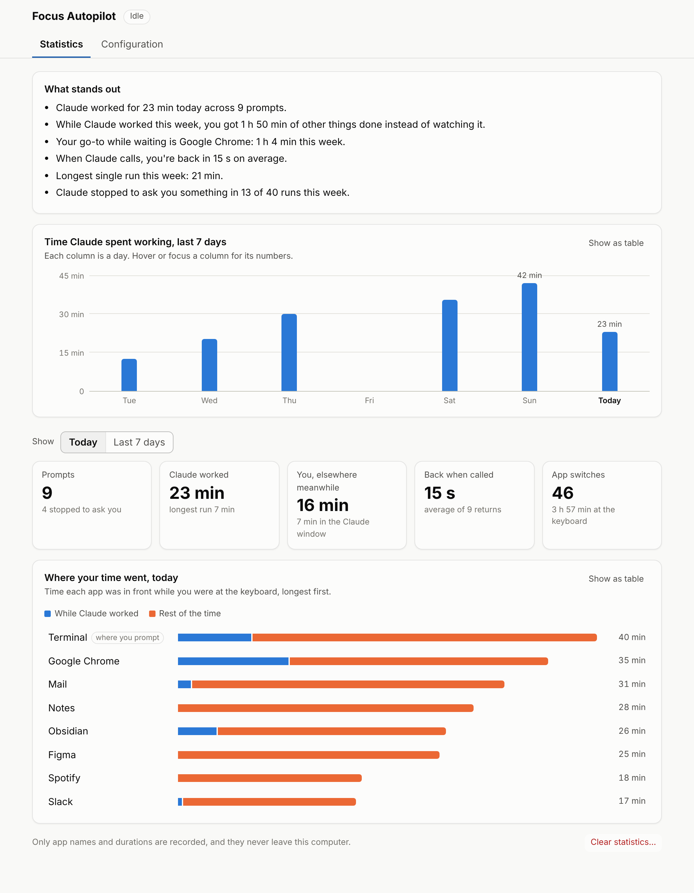
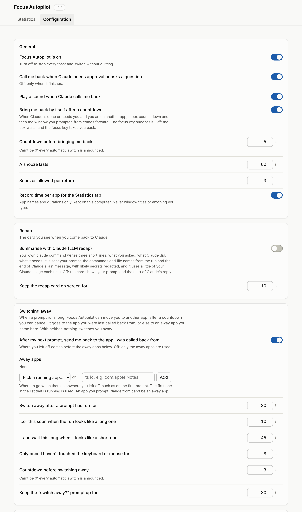
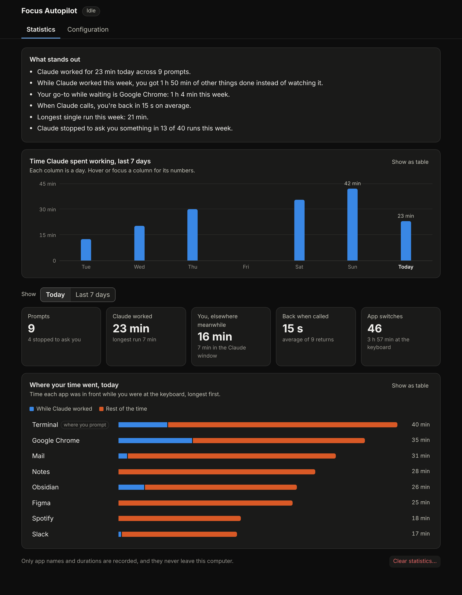
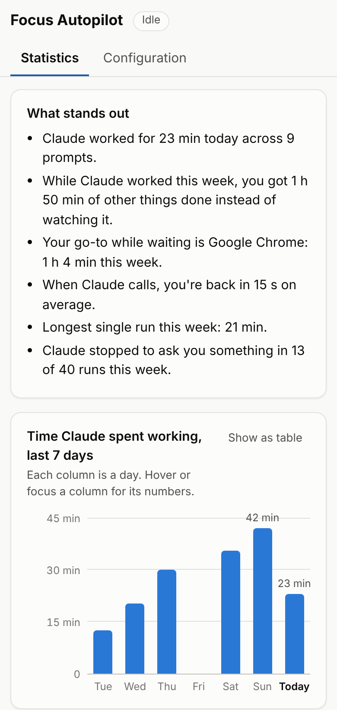

# Focus Autopilot

[](https://github.com/firedash/focus-autopilot/actions/workflows/ci.yml)

**Never lose a finished agent.** When Claude Code finishes, or stops to ask for your
approval, while you are in another window, Focus Autopilot plays a sound, counts down, and
brings you back to the window you prompted from with a recap of what happened. Once your
next prompt is running, it sends you back to the app you were working in.

**How it differs from what exists.** Notification hooks and notifier tools tell you Claude
is done, and session dashboards list what is running; finding the window, working out what
happened and getting back to your own work are left to you. This does those three: it brings
you back, shows the recap, and returns you to where you left off. The Claude desktop app's
own notification already does the first two with one click, so if you use that app, read
"Why not just a notification hook?" below before installing this.

1. You send a prompt and go wherever you like: another window, another app, a break.
2. Claude finishes or needs you. A box appears at the top of the screen, with a sound:
   `Claude is done in api. Back to Terminal in 5 s.`
3. Five seconds later you are back in the terminal you prompted from, with this on screen
   for a few seconds:

   ```text
   Project: api
   Asked:   Add retry with backoff to the upload client
   Claude:  Added retry with exponential backoff to upload_client.rs and three tests. All tests pass.
   ```

4. You answer and send the next prompt. If it runs long, a box says so, and you are moved
   back to the app you were just in, where you left off.

Every switch is announced by a countdown first, and the focus key (`⌃⌥⌘Space`, that is
Control+Option+Command+Space, on a Mac; `Ctrl+Alt+Shift+Space` on Windows) stops it: "snooze" on the way back, "not now" on the way out. A switch waits for a pause in
your typing, so keystrokes don't land in the wrong window. If you were already back when
Claude finished, nothing is shown. Every box names the project, so several sessions running
at once can be told apart.

Prefer to be asked? Turn off "Bring me back by itself" and the box waits until you press the
key. Turn off "send me back to the app I was called back from" and nothing moves you away.

**What it is today:** a developer build, built from source, that one person has run on two
machines: on **macOS** with Claude Code in a terminal, and on **Windows** with a local
session in the Claude desktop app's Code tab. On both, the hooks arrived, the box appeared
and the countdown brought the Claude window back. The move back to where you left off has
been seen once on the Mac and not yet on Windows. [STATUS.md](STATUS.md) has the full table
of what a person has seen, what only a CI machine has run, and what nobody has tried.

It runs on your machine only, asks for no OS permission, and sends nothing anywhere by
default. (On Windows it sends one empty mouse event, no movement and no click, when Windows
refuses a switch; [PERMISSIONS.md](PERMISSIONS.md) says why and how to turn it off.) Secrets
typed into a prompt are redacted before they are stored or shown. It does
record, on your machine, how long each app is in front, to draw the Statistics tab below; one
switch on the Configuration tab turns that off.

## Get your first box

On Windows, follow [docs/windows-quickstart.md](docs/windows-quickstart.md) instead.

You need a Mac, Rust ([rustup.rs](https://rustup.rs)) and the Xcode command line tools
(`xcode-select --install`). It takes a few minutes, most of it the first build.

```bash
git clone https://github.com/firedash/focus-autopilot && cd focus-autopilot
cargo build --release -p focusd -p focusctl
./target/release/focusctl install-hooks     # adds the hooks to Claude Code, creates the token
./target/release/focusd                     # leave it running
```

Then start `claude` in another terminal window (restart any session that was already running),
give it a task, and switch to another app. No settings are needed. If no box appears,
`./target/release/focusctl doctor` checks the setup and says how to fix each failure. The full
guide is [docs/mac-quickstart.md](docs/mac-quickstart.md).

## Why not just a notification hook?

A `Stop` hook that plays a sound or runs `terminal-notifier` takes ten minutes to write, and
if a ping is all you want, use that. Focus Autopilot is built on the same hooks
(`focusctl install-hooks` adds them). The difference is what listens at the other end: not a
one-line command, but a program that knows which sessions are running, which window each
was prompted from, and which app you are in now.

| | A notification hook | Focus Autopilot |
| --- | --- | --- |
| Tells you Claude is done or needs approval | yes | yes |
| Gets you to the right window | you find it, or click the notification if the notifier supports that | by itself after a countdown; one key snoozes it |
| Avoids keystrokes landing in the wrong window | not its job | the switch waits for a pause in your typing |
| Says what happened | "Claude is done" | a card with what you asked and what Claude did or needs |
| Gets you back to your own work | no | sends you back to the app you left, once the next prompt is running |
| Several sessions at once | one ping each | names the project, and settles every session waiting in the same window together |
| Shows where the waiting time went | no | the Statistics tab |

What it costs you over a hook: a background program to run, and a build from source today.

**If you use the Claude desktop app, look at its own notification first.** When a session
finishes, the app shows a notification with the session's name and a one-line summary, and a
click on it opens the app (seen on Windows, 2026-11-17). That already covers "tell me, tell
me what happened, take me back". What Focus Autopilot adds there is the return with no
click, the move back to the window you left, and the statistics. Whether that is worth a
background program is a fair question, and a week of use is the way to answer it.

## Where it runs

Two places have been run: **Claude Code in a terminal** on a Mac, and **the Claude desktop
app's Code tab** on Windows. Focus Autopilot listens to Claude Code's hooks, and Anthropic's
documentation says Claude Code fires the same hooks wherever it runs, so other places
*should* work with the same install. For the rows marked "no" that is a reading of the docs,
not something verified here. Each one also needs its app in the home-app list; if it is missing,
`focusd` says so and prints the line to add.

| Where you run Claude Code | Tested | What is known |
| --- | --- | --- |
| Terminal (Terminal, iTerm2, Ghostty, Warp, ...) | yes, on a Mac | works |
| VS Code, Claude Code extension | no | Anthropic's docs say the extension shares `~/.claude/settings.json` with the CLI, hooks included |
| Cursor, same extension or `claude` in its terminal | no | the docs offer the extension for Cursor; `claude` in a terminal inside it is the terminal case. Cursor's own built-in agent is a different product with its own hooks and is not supported |
| Claude Desktop app, Code tab, local session | yes, on Windows | the prompt, tool uses, the finish and a sub-agent's end all reached `focusd`, the window was recognised as `claude.exe`, and the return brought it forward. Approval events and the Mac app are untried. A cloud session runs elsewhere and fires no hooks on your machine, and the chat tab is not Claude Code |
| JetBrains IDEs | no | Anthropic's hooks page does not mention JetBrains, so nothing is known |
| Claude Code on the web or other cloud sessions | not supported | they fire no local hooks |

On a Mac a return goes to the app, not a specific window: with several windows of one editor
you land in whichever one macOS raises. On Windows it goes to the exact window.

## Also included, all optional

None of these is needed for the above.

- **A pause key**, `⌃⌥⌘P`: no boxes until you press it again.
- **A three-line recap** written by your own `claude` command (`Asked`, `Did`, `Needs`) in
  place of the card above. Off by default, because it uses a little of your Claude usage:
  set `[recap] mode = "llm"`.
- **An away app.** Name one and a long first prompt moves you there, when there is nowhere
  you left off yet. A third hotkey, off by default, says "this one will take a while, switch
  me now".
- **Start at login** (macOS only): `focusctl install-agent`. Not yet seen running under
  `launchd`.
- **A statistics and configuration page**, opened with `focusctl ui`. **Statistics** shows
  where your time went while Claude worked; **Configuration** changes every setting without
  editing a file. It has run in Chromium on Linux against the simulator, and not yet against
  a real `focusd` on a Mac or on Windows.

These pictures use made-up data (`scripts/ui-check/seed.py`),
not anyone's real usage; `scripts/ui-check/screenshots.sh` regenerates them.

**Statistics**: what stands out, how long Claude worked each day, and where your time went
while it did.



**Configuration**: every setting, changed in place and applied at once. A change that would
break a rule is refused with the reason, and your `config.toml` and its comments are left alone.



Dark mode and a phone-width layout, both automatic:

<p>

&nbsp;

</p>

## Not built

- **Windows, beyond a first build.** Start at login is not built for Windows, and the LLM
  recap and the page are untried there.
- **An installer, a Homebrew formula, a menu-bar icon, a click on the box.** `focusd` runs in
  a terminal or from the launch agent.
- **Return to an exact window on macOS.** There, switches go to the app; with several
  windows of one app you land in whichever macOS raises.

[STATUS.md](STATUS.md) has the full list.

## For contributors

The design is [docs/design.md](docs/design.md), "Focus Autopilot — Feature Backlog & Technical
Design (v1: Claude Code on macOS and Windows)"; section numbers in code comments refer to it.
The design and the code call the optional app it switches you to the "away app". The design
describes what is built; the records in [docs/adr/](docs/adr/) say why each choice was made.
The design as first written, before the build, is kept in
[docs/design-original.md](docs/design-original.md), and is what the records mean by "the
design".

### Layout

```
crates/
  focus-core/      every decision; no I/O, no unsafe, no dependencies
  focus-platform/  the Platform, Overlay and Hotkeys traits, home apps, macOS adapter, a fake
  focus-receiver/  loopback hook receiver, payload parsing, config loading, and the page
    assets/ui/     the Statistics and Configuration page: plain HTML, CSS and JavaScript
  focus-runner/    the shell loop, time per app, statistics, settings, run history
  focus-headless/  dev runner: receiver + core + fake platform, effects printed
  focusd/          the daemon (macOS): receiver + core + real platform adapter
  focusctl/        hooks, token, the page, doctor, launch at login
scripts/
  check-repo.py    repository rules: required files, SPDX headers, dependency entries
  ui-check/        drives the page in a real browser
docs/adr/          architecture decision records
```

Trust documents: [SECURITY.md](SECURITY.md), [THREAT_MODEL.md](THREAT_MODEL.md),
[PERMISSIONS.md](PERMISSIONS.md) (it asks for none), [AUDIT.md](AUDIT.md) (where each thing it
does to your machine lives in the code), [DEPENDENCIES.md](DEPENDENCIES.md).

### Try it anywhere (fake platform)

```bash
cargo run -p focus-headless -- --port 47821
```

It prints a token and the address of the page (`ui: http://127.0.0.1:47821/ui/#t=...`). Send
hooks with `curl -H "X-Focus-Token: <token>" -H "Content-Type: application/json" -d
'{"hook_event_name":"UserPromptSubmit","session_id":"s1","cwd":"/w","prompt":"hi"}'
http://127.0.0.1:47821/hook`, then a `Stop` event, and watch the toasts and recap. Type
`front <app id>` to play the user switching apps. To see the page with data in it:

```bash
scripts/ui-check/run.sh        # seeds made-up data and checks the page in Chromium
```

### Check it

```
cargo fmt --check
cargo clippy --workspace --all-targets
cargo test --workspace
python3 scripts/check-repo.py
```

CI runs these on Linux, builds and tests on macOS, and runs `cargo deny`. The macOS code can
also be type-checked from Linux: `rustup target add aarch64-apple-darwin`, then
`cargo clippy --workspace --all-targets --target aarch64-apple-darwin`.

License: Apache-2.0, see [LICENSE](LICENSE).
