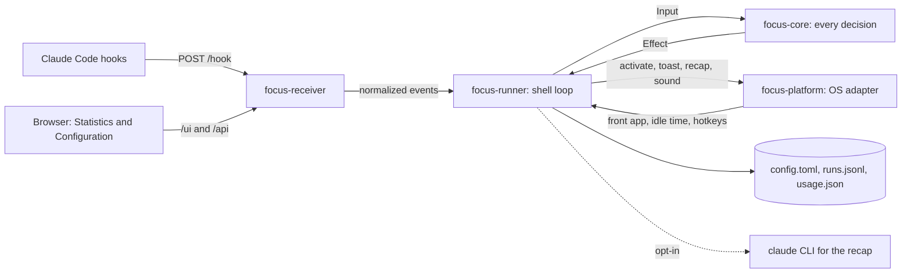
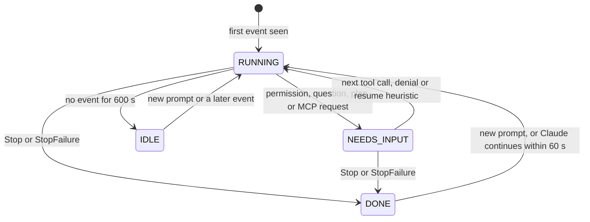

# Focus Autopilot — Feature Backlog & Technical Design (v1: Claude Code on macOS and Windows)

Rewritten 2026-11-17 to describe what is built · firedash

**How to read this.** This document describes the app as it is built. Three other places
hold what it deliberately leaves out:

| For | Read |
| --- | --- |
| Why each choice was made, and what was tried and withdrawn | The decision records in [adr/](adr/) |
| What has been seen working on a real Mac or Windows desktop, and test counts | [STATUS.md](../STATUS.md) |
| The design as first written on 2026-11-14, with its market survey, build plan and build prompt | [design-original.md](design-original.md) |

The decision records call that first version "the design" and say where they depart from
it. Their conclusions are folded into the text below, so this file and the records should
agree; if they don't, the newer of the two is right and the other needs fixing.

Section numbers are stable. Code comments cite them (`design section 7`), so a section may
be rewritten but not renumbered.

Things that are planned but not built are marked **Not built** where they appear, and listed
together in section 4.

## 1. Overview

Focus Autopilot is a local background program that moves a developer between prompting a
coding agent and steady work in another app, driven by the agent's state. It supports Claude
Code only. When Claude finishes or needs approval while you are elsewhere, it plays a sound,
counts down and brings you back to the window you prompted from, with a short recap. Once
your next prompt has been running for a while, it moves you back to the app you left.

**Problem.** Prompt-and-wait coding leaves idle gaps that vary from seconds to 20 minutes.
Moving to other work means either checking back constantly or forgetting to return.
Notification hooks tell you Claude is done; finding the window, working out what happened and
getting back to your own work are left to you.

**Target user.** A developer running Claude Code who wants to use wait time for steady work
of their own choosing, without forgetting to return.

**What v1 does**

- Detects when a Claude Code turn starts, needs input and ends, using Claude Code hooks.
- Brings the user back to the window they prompted from, after a countdown, when Claude is
  done or needs them.
- Moves the user away on a long run: to the app they left off in, or else to a configured
  away app.
- Announces every automatic switch with a countdown that one key stops, and waits for a
  pause in typing before switching, so keystrokes don't land in the wrong window.
- Shows a recap card on return: what you asked, what Claude did, what needs a decision.
- Estimates wait length from elapsed time, local history and live events, to decide when to
  switch away.
- Serves a local page with statistics and every setting.
- Runs on macOS and Windows from one codebase: a shared core with one adapter per OS.
- Keeps everything on the machine by default, and asks for no OS permission.

**Non-goals for v1**

- Agents other than Claude Code. Cursor's own agent, Codex and others have different hook
  systems.
- Linux, except for the headless test runner.
- Pausing or controlling the away app, or any app-specific integration.
- Approving permission prompts or answering Claude's questions.
- Reading keystrokes, screen contents, window titles or Claude Code transcripts.
- Claude Code sessions running in the cloud, which fire no local hooks.
- Cloud sync, accounts, analytics, multi-machine use, mobile apps.

**Supported platforms.** macOS 14 or later; Windows 10 and 11. Both are built from source;
there is no installer. Two surfaces have been run end to end: Claude Code in a terminal on a
Mac, and a local session in the Claude desktop app's Code tab on Windows. Other surfaces
(IDE extensions, the desktop app on a Mac) fire the same hooks according to Anthropic's
documentation and are untried; STATUS.md keeps the list. English only.

**Terms**

| Term | Meaning |
| --- | --- |
| Session | One Claude Code conversation, identified by `session_id` |
| Run | One prompt and everything Claude does until it stops, identified by `prompt_id` |
| Home app | An app a prompt can be sent from: a terminal, an IDE, the Claude app. A built-in list, extended by `home.extra_apps` |
| Home window | The window a run's prompt was sent from. On macOS this is the app; on Windows the exact window |
| Left-off app | The app the user was in when they last came back to a home window while Claude was working or waiting |
| Away app | An app named in `away.apps`. Optional; used when there is no left-off app |
| Switch | An automatic focus change, always announced by a countdown |
| Toast | The small box that announces a switch or asks a question. The code and the user-facing text also call it "the box" |
| Prompt (toast) | A toast that asks and waits ("Go back?", "Switch to Obsidian?"), shown when an automatic switch is refused, unsafe or turned off |
| Focus key | The hotkey that acts on whichever toast is showing |
| focusd | The always-running program |
| focusctl | The command-line tool for hooks, the token, the page, diagnostics and launch at login |

## 2. Working model and product principles

The unit of work is the dispatch, wait, review loop, not a clock block. Attention belongs at
the two ends: writing the prompt and reviewing the result. The wait in the middle should be
spent according to how long it is.

**Wait-time tiers.** The boundaries are fixed in `estimator.rs`; what each tier does to the
away switch is configurable (section 9).

| Tier | Expected wait | Behavior |
| --- | --- | --- |
| Short | under 30 s | Stay put. Leaving costs more than it saves |
| Medium | 30 s to under 5 min | Switch away early |
| Long | 5 min and over | Switch away early |

**Principles**

1. **Never surprise the user.** Every automatic switch is preceded by a visible countdown
   that the focus key cancels or snoozes. A countdown of 0 is refused by config validation.
2. **React to elapsed time first, predict second.** Agents give no ETA, so the app decides
   from elapsed time and refines with history and live tool events (section 9).
3. **Steady work must be easy to leave.** Work that can be put down at any moment fits best.
   An app flagged immersive gets a longer countdown with a warning.
4. **Return with context.** A recap card names the prompt, what Claude did and any decision
   needed.
5. **Stay out of the agent's way.** Hooks are answered at once and never veto anything. If
   focusd is down, Claude Code works as before.
6. **The user is always in control.** One hotkey pauses all automation, and two settings
   turn the automatic switches into questions (section 7).
7. **Only manage a context the user is in.** Switch away only from a run's home window.
   Bring the user back from any app, except a window that holds another Claude session:
   someone working with one session is asked, not moved, when another finishes.
8. **Observe as little as possible.** focusd reads the frontmost app, the list of running
   apps, global idle time and hook events. It never reads keystrokes, window titles, screen
   contents or transcripts.

## 3. Market snapshot

No tool found in November 2026 ran the full loop: switch away on a long prompt, switch back
on completion, with a recap, for real apps. Existing tools covered one piece each: focus-back
extensions and notification hooks (one direction, no recap), waiting games (in the terminal
or an overlay, not your own apps), and session dashboards (monitoring only).

Two findings shaped the product. Claude Code's terminal already shows its own recap when you
return to a session, so this recap had to work across apps. And users file issues asking
agents to stop stealing focus, so the countdown and snooze are requirements, not polish.

The survey table with links is in
[design-original.md, section 3](design-original.md#3-market-snapshot). It was built from web
search results on 2026-11-13 and was not exhaustively verified. The README's "Why not just a
notification hook?" compares against the simplest alternative.

## 4. Feature backlog

IDs are stable; code comments and decision records cite them. The acceptance criteria as
first written are in [design-original.md](design-original.md#4-feature-backlog). "Built"
means the code exists and is tested against the fake platform or on Linux. STATUS.md says
what has been seen working on a real desktop.

| ID | Feature | Status | As built |
| --- | --- | --- | --- |
| A1 | `focusctl install-hooks` and `uninstall-hooks` | Built | Section 6. Also `--scope user/project/local` and `--settings FILE` |
| A2 | Hardened local event receiver | Built | Section 6 and 13. The 10 ms reply budget has not been measured |
| A3 | `focusctl record` for scrubbed fixtures | Not built | Fixtures are hand-written |
| A4 | `focusctl rotate-token` | Built | |
| B1 | Per-session state machine and switch controller | Built | Section 7 |
| B2 | Resume heuristic after a needs-input pause | Built | Counts input only while the home window is in front (ADR 0001 item 8) |
| C1 | macOS and Windows adapters | Built | Section 8. The front app is polled, not notified |
| C2 | Home window captured at prompt submit | Built | App on macOS, exact window on Windows |
| C3 | Ordered away-app list | Built, changed | The left-off app comes first, then `away.apps` (ADR 0005 item 4) |
| C4 | Immersive flag for away apps | Built | Countdown of at least 5 s, with a warning line |
| C5 | Exact-window return on macOS | Not built | Two routes examined; one tried and withdrawn (ADR 0003 items 16, 21) |
| C6 | Forceful activation on Windows | Built, changed | One empty mouse event when Windows refuses, on by default (ADR 0006 item 4) |
| D1 | Away switch after the threshold | Built, changed | No idle time required by default; 8 s hold-off after coming back (ADR 0005 item 5) |
| D2 | Return on Stop, a permission prompt or a question | Built, changed | A countdown from any app, not only from an away app (ADR 0005 item 1) |
| D3 | Countdown toast with cancel and snooze | Built, changed | The focus key only. The toast ignores the mouse, so it cannot be clicked |
| D4 | Pause | Partly built | The pause hotkey toggles it. The core accepts timed pauses but nothing offers them |
| D5 | Debounce rules | Built | Section 7 |
| D6 | Input-quiet guard | Built | Section 7 |
| D7 | Prompt when the OS refuses a switch | Built | The focus key completes the switch |
| D8 | Sound on return | Built | |
| D9 | Suggest an away activity by tier | Not built | V2 |
| D10 | Pause integration for away apps | Not built | Later |
| F1 | Basic recap card | Built | Section 10. Also names the project and other waiting sessions |
| F2 | LLM recap through the local Claude Code CLI | Built, changed | The basic card is held back, not shown and replaced (ADR 0003 item 4) |
| F3 | Run statistics on the card | Built | |
| E1 | Run history in a JSON Lines file | Built | Section 11 |
| E2 | History-based estimate chooses the tier | Built | Section 9 |
| E3 | Live signals raise the estimate | Built | A test command gives Medium, not Long; both switch at 10 s (ADR 0002 item 4) |
| E4 | Declare-long hotkey | Built | Off by default |
| E5 | Learned model beyond the median | Not built | Later |
| H1 | Queue returns from several sessions | Built | Section 7 (ADR 0002 item 5) |
| G1 | TOML config with defaults and live reload | Built, changed | An unknown key is an error, not a warning (ADR 0003 item 22, ADR 0004 item 6) |
| G2 | First-run wizard | Not built | `focusctl install-hooks` and the Configuration tab cover setup |
| G3 | Launch at login | Partly built | macOS only: `focusctl install-agent` writes a launch agent. Not built for Windows |
| G4 | `focusctl doctor` | Built | Checks the config, the hooks, the receiver, events seen, the `claude` CLI and the launch agent |
| G5 | Ignore projects by folder pattern | Built | Pattern rules in ADR 0002 item 8 |
| G6 | Away-app profiles by project or time of day | Not built | V2 |
| I1 | Local dashboard | Built early | The Statistics tab (section 8, ADR 0004). It also records time per app, which the first design did not |
| O1 | Repository trust files | Built | No CHANGELOG or REPRODUCIBLE.md |
| O2 | CI on every pull request | Partly built | Section 13 |
| O3 | Negative tests and fuzz targets | Partly built | Negative tests over a real socket; no fuzz targets |
| O4 | No telemetry, no outbound network | Built | True by construction; the `strace` test that would enforce it is not built |
| O5 | Signed releases with checksums, SBOM, provenance | Not built | |
| J1 | Codex adapter | Not built | V2 |
| J2 | Adapters for Cursor, Antigravity, Gemini CLI | Not built | V2 |
| J3 | Linux | Not built | V2. `focus-headless` runs there with a fake platform |

Also not built, and not in the backlog: a menu-bar or tray icon, an installer, changing
hotkeys without a restart, statistics per project, and `focusctl audit`.

## 5. Architecture

One local process, `focusd`, receives Claude Code hook events over HTTP, tracks each
session's state, decides when to switch, moves focus through an OS adapter, and shows a
countdown and a recap. Nothing leaves the machine except the opt-in recap, which runs the
user's own `claude` command.



The core is the only part that decides. The platform crate is the only part that touches
other apps.

**Stack.** A Rust workspace with no UI framework. The on-screen boxes are native windows in
`focus-platform`; the settings and statistics page is three static files served by the
receiver. The first design proposed a Tauri shell with a tray and a wizard; it was not used
(ADR 0003 item 2, ADR 0004 item 1).

**Crates**

| Crate | Responsibility | Rules |
| --- | --- | --- |
| `focus-core` | Session state machines, guards, the switch controller, the estimator, recap text, redaction | No I/O, no OS calls, no `unsafe`, no dependencies |
| `focus-receiver` | The loopback HTTP server, request checks, payload parsing into normalized events, `config.toml` parsing, and the page's files and API routes | No OS calls; runs headless in tests |
| `focus-platform` | The `Platform`, `Overlay` and `Hotkeys` traits; the macOS and Windows adapters; a fake for tests; the built-in home-app list | The only crate allowed `unsafe`, each block with a `// SAFETY:` comment |
| `focus-runner` | The shell loop shared by both runners; time per app; statistics; the settings the page may change; run history; the recap CLI call | |
| `focusd` | The daemon: receiver, core and the real adapter | macOS and Windows |
| `focus-headless` | A dev runner: receiver, core and the fake platform, with effects printed | Runs anywhere |
| `focusctl` | Hooks, the token, the page launcher, `doctor`, launch at login | |

**Core contract.** `focus-core` is a deterministic state machine: inputs and the time go in,
effects come out, and there is no I/O. The shell owns every side effect, so each decision is
testable with recorded traces and a fake clock. The definitions live in `focus-core/src/io.rs`
and `events.rs`; this is their shape:

```rust
pub enum Input {
    Hook(AgentEvent),            // normalized Claude Code payload (section 6)
    Observed(Observation),       // front app, idle time, running apps, activation result
    User(UserAction),            // focus key, pause, resume, declare-long
    Config(Box<Config>),         // a saved or hand-edited config, applied live
    History(Vec<RunSample>),     // past runs from runs.jsonl, at startup
    Summary { id, text },        // the LLM recap's reply
    SummaryFailed { id },        // the CLI failed; show the basic card now
}

pub enum Effect {
    ShowToast(Toast),
    HideToast,
    Activate { target, verify_after },  // the shell verifies and reports back
    Probe(ProbeKind),                   // read idle time, the front app or running apps now
    ShowRecap(RecapCard),
    PlaySound(Sound),
    AppendRun(RunRecord),               // one line for runs.jsonl
    SummarizeRecap { id, prompt, timeout },
    Log(LogEvent),                      // an event name and a session id, never content
}

impl Core {
    pub fn new(config: Config, known_home_apps: Vec<String>) -> Self;
    pub fn handle(&mut self, input: Input, now: Instant) -> Vec<Effect>;
    pub fn tick(&mut self, now: Instant) -> Vec<Effect>;
    pub fn next_deadline(&self) -> Option<Instant>;
}
```

`Core::new` takes the built-in home-app list because that list lives in `focus-platform`,
which depends on the core (ADR 0001 item 1).

**Shell loop.** `focus-runner` runs the core on one thread. Each pass carries out the effects
from the pass before, then sleeps until the next message or the earliest deadline among the
core, the overlay and its own polls. Hooks and typed commands arrive on one queue. Window,
overlay and hotkey calls run on that same thread, which on macOS is the main thread.

**Polling.** The core asks for idle time only when a decision needs it: once a second while
an away switch could start or a session at the home window awaits an answer, and every
100 ms during the input-quiet wait (ADR 0001 item 3). Separately, the shell reads the front
app twice a second on both OSes; neither adapter subscribes to change notifications yet
(ADR 0003 item 7, ADR 0006 item 7).

**Platform layer.** Three traits in `focus-platform/src/lib.rs`, each with a macOS
implementation, a Windows implementation and a fake:

```rust
pub trait Platform {
    fn frontmost(&self) -> Result<Option<AppRef>>;   // id, name, pid; window handle on Windows
    fn watch_frontmost(&self, tx: Sender<Option<AppRef>>);
    fn running_apps(&self) -> Result<Vec<AppRef>>;
    fn seconds_since_input(&self) -> Result<f64>;    // global idle time, never input content
    fn activate(&self, target: &AppRef) -> Result<()>; // a request; the core verifies it
    fn play_sound(&self, sound: Sound);
}

pub trait Overlay {
    fn show_toast(&self, text: &str);
    fn hide_toast(&self);
    fn show_recap(&self, lines: &[String], for_how_long: Duration);
    fn tick(&self, now: Instant);
    fn next_deadline(&self) -> Option<Instant>;
}
```

`Hotkeys` registers the configured chords and reports presses.

**Dependencies.** [DEPENDENCIES.md](../DEPENDENCIES.md) lists every direct dependency with
its purpose, license and why the standard library is not enough; CI fails when one is added
without an entry. In short: `hyper` and `tokio` for the loopback server, `serde`, `serde_json`,
`toml` and `toml_edit` for parsing and editing, `subtle`, `getrandom` and `sha2` for the token
and project hashes, `objc2` crates on macOS and `windows-sys` on Windows. Not used: an HTTP
client, telemetry or crash reporting, an auto-updater, a database, Node.js or npm.

## 6. Claude Code integration

Claude Code gives hooks no ETA, progress, duration or token counts, so focusd works from
event timing and a few payload fields. Every event below supports the `http` hook type.
`SessionStart` doesn't, which is why focusd doesn't use it
([hooks reference](https://code.claude.com/docs/en/hooks), read 2026-11-14).

**Hooks registered**

| Event | Matcher | focusd uses it to | Fields read |
| --- | --- | --- | --- |
| UserPromptSubmit | none | Start a run and capture the home window | `permission_mode`, `prompt` |
| PreToolUse | all tools | Count tools, spot slow commands, questions and touched files; leave needs-input | `tool_name`, `effort.level`; from `tool_input` only `command` (Bash, PowerShell) and `file_path` (Edit, Write) |
| PermissionRequest | all tools | Enter needs-input | `tool_name`, and the same two `tool_input` fields |
| PermissionDenied | all tools | Leave needs-input | none |
| Notification | `permission_prompt`, `elicitation_dialog`, `elicitation_url_dialog` | Backup needs-input signal | `notification_type` |
| Elicitation | all MCP servers | Enter needs-input: an MCP server is asking the user | `mcp_server_name` |
| SubagentStart, SubagentStop | all agent types | Count sub-agents and raise the estimate | none |
| Stop | none | End the run | `stop_hook_active`, `last_assistant_message`, the number of `background_tasks` |
| StopFailure | all errors | End the run with an error | `error` |
| SessionEnd | all reasons | Forget the session | none |

Every event also carries `session_id`, `prompt_id`, `cwd` and `hook_event_name`. If
`prompt_id` is missing, as on an older Claude Code, the event belongs to the session's
current run.

**Questions count as needs-input.** A PreToolUse for `AskUserQuestion` or `ExitPlanMode`
means Claude is waiting for the user, so it is handled like a permission prompt.

**Deliberately not registered.** PostToolUse and PostToolUseFailure carry full tool output
that focusd doesn't need, and fire too late to help. Stop doesn't fire when the user
interrupts with Esc, so section 7 handles interrupts with a staleness rule.

**Payload handling.** The receiver deserializes only the fields above into typed structs;
a field of an unexpected type reads as absent. Bodies over 8 MB are refused. Kept strings
are stripped of control characters and ANSI escapes, redacted (section 10) and truncated:
prompt 500 characters, message 1,500, command 200, path 300. Redaction reads 128 characters
past the cut so a key that straddles it is seen whole. Payloads carry no timestamp, so each
event is stamped with a monotonic receive time. The receiver also computes the project key,
a salted hash of `cwd`, so the core needs no hashing, and the prompt's full length before
truncation, which the estimator buckets (ADR 0002 item 1).

**Hook entries.** Every event uses the same receiver URL; the event name comes from
`hook_event_name` in the body. A minimal pair:

```json
{
  "hooks": {
    "UserPromptSubmit": [
      { "hooks": [ { "type": "http", "url": "http://127.0.0.1:47821/hook",
                     "timeout": 2, "headers": { "X-Focus-Token": "<token>" } } ] }
    ],
    "Notification": [
      { "matcher": "permission_prompt|elicitation_dialog|elicitation_url_dialog",
        "hooks": [ { "type": "http", "url": "http://127.0.0.1:47821/hook",
                     "timeout": 2, "headers": { "X-Focus-Token": "<token>" } } ] }
    ]
  }
}
```

HTTP hooks run synchronously, so the receiver answers at once with `200` and an empty body,
which Claude Code treats as success with no decision. `timeout: 2` caps the delay if focusd
ever hangs.

**Token.** The installer writes a random 256-bit token into each entry and into
`config.toml`. It stops web pages and other users' processes from posting events. It doesn't
stop software already running as the user, which can read both files (section 13).
`focusctl rotate-token` replaces it in the config and the hooks in one step.

**Installer rules (`focusctl`)**

- The target is the user-level `~/.claude/settings.json` (`%USERPROFILE%\.claude\settings.json`
  on Windows) so every project is covered. `--scope project` or `--scope local` writes the
  project's files instead; `--settings FILE` names one.
- `--dry-run` prints the change and writes nothing. A real run backs the file up beside
  itself, merges, writes a temporary file in the same folder and renames it over the
  original. The first backup is kept and never overwritten.
- If the file is a symlink, as dotfile managers create, the write goes to its target.
- If the file isn't strict JSON (comments, for example), the installer stops and changes
  nothing.
- Key order is kept. focusd's entries go beside existing hooks and never replace them.
  They are the entries whose URL starts with `http://127.0.0.1:<port>/hook`; uninstall
  removes only those.
- If the file changes between read and rename, the installer starts over, at most 3 times.
- `uninstall-hooks` restores the first backup's exact bytes when its content matches what
  the uninstall produced, so formatting survives a round trip (ADR 0003 item 10).

**Things that stop hooks firing.** Claude Code holds back all hooks until the folder's
workspace trust dialog is accepted. Sessions started before the install need a restart.
Organizations can restrict HTTP hook URLs with `allowedHttpHookUrls`. `focusctl doctor` names
these when focusd is running but has seen no events.

**When focusd isn't running**, Claude Code treats each failed hook as a non-blocking error.

**WSL.** Claude Code inside WSL2 cannot reach a focusd on Windows by default, because WSL's
`127.0.0.1` is not Windows's. Nothing detects or works around this yet (ADR 0006 item 9).

**First fixture.** `focus-core/tests/fixtures/approve_then_tests.jsonl` is a synthetic trace.
`_t_ms` is the receive time in milliseconds since the trace started; it isn't part of
Claude's payload.

```json
{"_t_ms":0,"hook_event_name":"UserPromptSubmit","session_id":"s1","prompt_id":"p1","cwd":"/work/app","permission_mode":"default","prompt":"Run the tests and fix failures"}
{"_t_ms":4100,"hook_event_name":"PreToolUse","session_id":"s1","prompt_id":"p1","cwd":"/work/app","tool_name":"Bash","tool_use_id":"t1","tool_input":{"command":"npm test"},"effort":{"level":"high"}}
{"_t_ms":4200,"hook_event_name":"PermissionRequest","session_id":"s1","prompt_id":"p1","cwd":"/work/app","tool_name":"Bash","tool_input":{"command":"npm test"}}
{"_t_ms":95000,"hook_event_name":"PreToolUse","session_id":"s1","prompt_id":"p1","cwd":"/work/app","tool_name":"Edit","tool_use_id":"t2","tool_input":{"file_path":"/work/app/src/sum.ts"}}
{"_t_ms":131000,"hook_event_name":"Stop","session_id":"s1","prompt_id":"p1","cwd":"/work/app","stop_hook_active":false,"last_assistant_message":"Fixed the failing sum test; all 42 tests pass.","background_tasks":[]}
```

## 7. Session state machine and policy rules

Two state machines live in `focus-core`. Each session has its own (`session.rs`). One switch
controller serves all sessions, because focus is global (`mode.rs`, `engine.rs`, `away.rs`,
`returns.rs`, `actions.rs`, `guards.rs`).

### Sessions

Each Claude Code session is in one of four states.



| Event | From | To | What happens |
| --- | --- | --- | --- |
| UserPromptSubmit | any | RUNNING | A new run: `prompt_id`, start time, prompt (memory only), an estimate from history. Home is the frontmost window if it is a home app. The run it replaces is written to history |
| PreToolUse, SubagentStart | RUNNING | RUNNING | Counters, touched files and the estimate are updated |
| PermissionRequest, Elicitation, a needs-input Notification, or PreToolUse for `AskUserQuestion` or `ExitPlanMode` | RUNNING | NEEDS_INPUT | What is needed is noted (memory only). The session starts waiting for the user |
| PreToolUse, PermissionDenied or SubagentStart | NEEDS_INPUT | RUNNING | Claude moved on, so the user or a hook answered |
| A second request, or the backup Notification | NEEDS_INPUT | NEEDS_INPUT | Still waiting; nothing changes |
| Resume heuristic: input after entering NEEDS_INPUT while the home window is in front, then `resume_idle_seconds` (8) without input | NEEDS_INPUT | RUNNING | Most likely a long tool was approved; the away guards apply again |
| Stop | RUNNING or NEEDS_INPUT | DONE | The run closes. The session starts waiting for the user |
| StopFailure | RUNNING or NEEDS_INPUT | DONE | As Stop; the recap shows the error |
| A Stop with `stop_hook_active`, or an event that shows Claude working within 60 s of the Stop, before the run is written to history | DONE | RUNNING | A Stop hook made Claude continue. No second away switch in this run |
| SubagentStop, PermissionDenied or an ordinary Notification | DONE or IDLE | unchanged | A straggler from the run that just ended; ignored |
| An event that shows Claude working, later than that | DONE or IDLE | RUNNING | A new run with no home window, so nothing switches for it |
| No event for `stale_after_seconds` (600) | RUNNING | IDLE | The run closes quietly, with no return and no recap. Covers interrupts and crashes |
| SessionEnd | any | removed | The session is dropped and its run written to history |
| First event of an unknown session, other than a prompt | none | RUNNING | focusd started mid-run. No home window, so nothing switches for it |
| An event whose `prompt_id` isn't the current run's | any | unchanged | A late event from an earlier run; ignored |

At most 256 sessions are tracked; events from further new sessions are dropped. Events from
a folder matching `ignore.cwd_globs` are dropped before anything else.

**When a session is waiting for the user.** A session with a home window is waiting when it
is DONE, or has been in NEEDS_INPUT for `needs_input_debounce_seconds` (2), until the user
has been back at its home window. A needs-input that clears within the 2 s was approved by a
hook or auto mode and never counts. `return_on_needs_input = false` makes only DONE count.
Waiting sessions are ordered needs-input first, then oldest first.

### Switch controller

The controller is in one of four modes and shows at most one toast. Apart from the mode it
keeps two records: whether focusd put the user in another app and when (`away`), and the
left-off app.

| Mode | Toast | What it is doing |
| --- | --- | --- |
| Idle | none | Watching for an away switch to start or a session to start waiting |
| Away countdown | "Claude will take a while. Switching to Obsidian in 3 s." | Counting, then waiting for a pause in input, then verifying the switch |
| Away prompt | "Claude will take a while. Switch to Obsidian?" | Waiting up to `away_prompt_seconds` (30) for the focus key |
| Return | "Claude is done in api. Back to Terminal in 5 s." or "Claude is done in api. Go back?" | Counting, waiting for a pause in input, verifying, snoozed, or asking |

Every automatic switch goes through the same three phases:

1. **Counting.** The countdown toast is showing.
2. **Quiet.** The countdown has ended. The switch waits for `input_quiet_ms` (600) without
   keyboard or mouse input. If input continues for `input_quiet_max_seconds` (5), a prompt
   replaces the switch, so a keystroke never lands in the wrong window.
3. **Verifying.** Activation was requested. The shell reads the front app `verify_after_ms`
   (400) later and reports whether the target is in front. No report within 2 s more counts
   as refused. A refused switch becomes a prompt.

### Switching away

An away countdown starts when all of these hold. They are checked in this order, and
`focusd` prints the first one that fails (`not switching away: ...`).

1. Automation is on: `enabled` is true and the app is not paused.
2. No session is in NEEDS_INPUT.
3. Some run is RUNNING, has a home window, and has not used its away switch.
4. That run has gone on for its tier's threshold (section 9). If the user has just come back
   to its home window from another app, at least 8 s have passed since, so coming back to
   look at Claude is not answered by being moved out again.
5. Its home window is in front.
6. The user has been idle for `away_requires_idle_seconds`. The default is 0, so by default
   this guard does nothing; the quiet phase is the safeguard that matters (ADR 0005 item 5).
7. There is somewhere to go, from a list of running apps read within the last 3 s.

**Where it goes.** First the left-off app, if `away.resume_last_app` is on, the app is still
running and no Claude session has been started in it. Otherwise the first running app in
`away.apps`. Otherwise nowhere. On Windows the left-off target is the exact window.

**The left-off app** is remembered when the user arrives at a window with a Claude session
in it, straight from an app with none, while Claude is working or waiting for them. A gap of
up to 5 s with nothing in front does not lose it. Arriving with nothing going on changes
nothing, so the first prompt of a sitting has no left-off app and uses `away.apps` if set.
It is kept in memory only (ADR 0005 items 4 and 6).

**During the countdown.** The focus key means "Not now": no away switch for the rest of the
run. The countdown is withdrawn if the run ends, a session needs input, the home window
stops being in front, or automation is paused. An immersive target gets at least 5 s and a
warning line.

**After the switch.** A verified switch uses up the run's away switch and sets the `away`
record. A refused one shows the away prompt, which also uses up the away switch, so the
prompt appears once (ADR 0001 item 5). The focus key on the prompt tries again.

**Declare-long.** The declare-long hotkey applies to the running session whose home window
is in front. It sets the Long tier, skips guards 4 and 6, and re-arms a switch cancelled
with "Not now". The other guards, the countdown and the quiet phase still apply (ADR 0002
item 6).

### Coming back

When a session starts waiting and the controller is idle:

- **The home window is already in front.** Nothing is shown. The session counts as seen.
- **The user is elsewhere.** The sound plays, and a return starts for the first waiting
  session.

A return is a countdown of `countdown.return_seconds` (5), then the quiet phase, then the
switch. It is a prompt instead, with the reason logged (`asked_because_...`), when:

- `switching.auto_return` is off.
- The user is in a window with another Claude session in it. An app that is merely on the
  home-app list, with no session, counts as any other app (ADR 0005 item 3).
- The run ended within `debounce_seconds` (5) of an away switch, so the user is not flipped
  straight back. This applies to Stop only, not to a permission prompt (ADR 0001 item 10).
- Input never paused during the quiet phase, or the OS refused the switch.

**During the countdown.** The focus key means "Snooze": the toast goes away for
`snooze_seconds` (60) and the countdown starts again. After `max_snoozes` (3) the prompt is
shown instead. On a prompt the focus key means "Go back now". A prompt stays until it is
acted on or no longer needed.

**Being back.** Whenever the home window is in front during a return, however the user got
there, the toast is hidden, the recap is shown, and every session waiting at that window is
settled together, because without window identity the core cannot tell which one the user
is looking at (ADR 0003 item 17). A session waiting at a different window stays queued and
gets its own return next; since the user is then in a window with a session, that one is a
prompt (ADR 0002 item 5).

**Coming back on your own.** If focusd moved the user away and they return to a window with
a session while no return is under way, the `away` record is cleared and any session waiting
at that window is settled. The recap is shown if they were away 20 s or more.

### Pause and several sessions

**Pause.** The pause hotkey toggles it. While paused, sessions keep updating and no toast is
shown. A session that finished during the pause gets its return when automation resumes, if
the user is still away (ADR 0001 item 11).

**Several sessions.** Guard 2 covers every session: nothing switches the user away while any
session needs them. Every toast and recap names the project, the last folder of `cwd`; two
live sessions in different folders with the same last name are both shown as `parent/name`
(ADR 0003 items 12 and 18).

**Known limits.** An interrupted run looks like one that is still thinking until a new
prompt arrives or 600 s pass. If Claude Code fires a PreToolUse for a second, parallel tool
call while a permission prompt is still open, the session will look like it is running; the
backup Notification should put it back, but the event order has not been confirmed against
real traces (ADR 0001, "Known risk").

## 8. Window switching, overlay and UI

Every OS call goes through `focus-platform` (section 5). None triggers an OS permission
prompt; [PERMISSIONS.md](../PERMISSIONS.md) states that as a promise and
[AUDIT.md](../AUDIT.md) lists every call with the file it is made in. Both OSes treat a
background app's request to change focus as something they may refuse, so the core verifies
every switch.

**Platform calls**

| Need | macOS 14 and later | Windows 10 and 11 |
| --- | --- | --- |
| Frontmost app and window | `NSWorkspace.frontmostApplication`, polled twice a second | `GetForegroundWindow` and the executable that owns it, polled twice a second |
| Running apps | `NSWorkspace.runningApplications`, regular apps only | Visible, titled, top-level windows from `EnumWindows`. The title's length is read, never the title |
| Global idle time | `CGEventSourceSecondsSinceLastEventType` | `GetLastInputInfo` |
| Activate | `NSRunningApplication.activateWithOptions` | `ShowWindow` to restore if minimized, then `SetForegroundWindow` on the saved window |
| Hotkeys | Carbon `RegisterEventHotKey`, hand-declared | `RegisterHotKey` |
| Overlay | Two borderless, non-activating `NSPanel`s that ignore the mouse | Two topmost, non-activating, click-through popup windows drawn with GDI |
| Sound | `NSSound` | `MessageBeep` |
| Launch at login | A launch agent plist written by `focusctl install-agent`; the user loads it | Not built |

**Why switches get refused.** Since macOS 14, activation is a request the active app may
decline, and a background app's request can fail silently
([Apple: cooperative activation](https://developer.apple.com/documentation/appkit/passing-control-from-one-app-to-another-with-cooperative-activation)).
Windows lets a process take the foreground only under conditions such as having received the
last input event
([Microsoft: SetForegroundWindow](https://learn.microsoft.com/windows/win32/api/winuser/nf-winuser-setforegroundwindow)).
A hotkey press is input to focusd, so the focus key on a prompt works where a timed switch
was refused.

**The one input focusd sends.** On Windows a switch made on a timer is normally refused. The
adapter asks plainly first. If the window did not come forward, it sends one mouse event that
moves nothing and presses nothing, which makes focusd the last process to receive input, and
asks again. This is on by default (`switching.force_foreground`), because without it nearly
every automatic switch on Windows would become a question. Off, a refused switch becomes the
prompt. The macOS adapter sends nothing (ADR 0006 item 4).

**Never used:** Apple Events, event taps, keyboard or mouse hooks, window titles, screen
capture, Accessibility, thread-input attachment, synthesized keystrokes or clicks, and
changes to the foreground-lock timeout.

**App identity.** An app is a bundle id on macOS and an executable name on Windows, such as
`WindowsTerminal.exe`. On Windows the window handle is kept too, and two references match
only if their handles do. So on Windows a return goes to the exact window the prompt came
from, falling back to the frontmost window of that executable if it is gone. On macOS
activation is per app: with several windows of one editor, the user lands in whichever
window the OS raises. Exact-window return on macOS is **not built**; the blocker is that a
hook names the project, not the window (ADR 0003 item 16).

**Capturing the home window.** At UserPromptSubmit the user has just pressed Enter, so the
frontmost app is the one the prompt came from. If it is a home app, it becomes the run's
home. If not (a script, another machine, an unlisted app), the run has no home, nothing
switches for it, and `focusd` prints the config line that would add the app.

Built-in home apps are in `focus-platform/src/known_apps.rs`, extended by `home.extra_apps`.
An entry ending in `*` matches by prefix. The ids were written from memory and are corrected
as surfaces are tested:

- macOS: Terminal, iTerm2, Ghostty, WezTerm, kitty, Alacritty, Warp, VS Code, VS Code
  Insiders, Cursor, Windsurf, Zed, JetBrains IDEs, Claude.
- Windows: Windows Terminal, the console host and the shells that can own a console window,
  WezTerm, Alacritty, Munder Difflin, VS Code, Cursor, Windsurf, JetBrains IDEs, Claude.

**Toasts.** One box at the top of the screen; on Windows, of the monitor that holds the
foreground window. It cannot take keyboard focus and it ignores the mouse, so every click
goes to whatever is underneath. Text is plain text. The focus key always does the thing that won't happen on its own.

| Toast | Example text | Focus key |
| --- | --- | --- |
| Away countdown | Claude will take a while. Switching to Obsidian in 3 s. | Not now |
| Away prompt | Claude will take a while. Switch to Obsidian? | Switch now |
| Return countdown | Claude is done in api. Back to Terminal in 5 s. | Snooze |
| Return prompt | Claude needs your approval in api. Go back? | Go back now |

The return headline is one of: Claude is done, needs your approval, has a question, needs
your input, or stopped with an error.

**Hotkeys.** Registered once at startup; a change needs a restart. A chord that cannot be
registered, such as one another program owns, is reported at startup. `focusd --test-hotkeys`
registers the chords and prints each press for 60 s.

| Hotkey | macOS default | Windows default |
| --- | --- | --- |
| Focus key | Control+Option+Command+Space | Ctrl+Alt+Shift+Space |
| Pause | Control+Option+Command+P | Ctrl+Alt+Shift+P |
| Declare-long | off | off |

On Windows, Ctrl+Alt+Space was the first default; the Claude desktop app owns it (ADR 0006
item 6). An empty string turns a hotkey off.

**Recap card.** A second box in the same place, shown for `ui.recap_seconds` (10). Its
contents are in section 10.

**Statistics and Configuration page.** A local web page served by focusd on the receiver's
port and opened with `focusctl ui`. It takes the place of the tray menu, settings window and
first-run wizard of the first design. **Statistics** shows where time went while Claude
worked; **Configuration** changes every setting in an explicit list, validates the whole
config before writing, keeps the file's comments, and applies the change at once. The page is
three static files with no framework and no build step. Its defences, the token handoff and
the data it reads are in [ADR 0004](adr/0004-statistics-and-configuration-page.md).

**Running focusd.** In a terminal, or from the launch agent. In a terminal it prints the
front app, each hook, each toast and each recap, and takes typed commands: `click` acts on
the toast, `pause`, `resume`, `quit`. When its output is a file it prints event names and
outcomes only, unless `--verbose` is given (ADR 0003 item 14). `--list-apps` prints the ids
of running apps, and `--test-box` shows both boxes without a run.

**Display limits.** The boxes float over normal and borderless windows. Exclusive
full-screen games may hide them or ignore a switch; the sound still plays.

## 9. Wait-time estimation

Claude Code gives no ETA, so the estimate is built in layers, each optional: if one has no
data, the one before it decides. The output is a tier and a range, never a single number.
The code is `focus-core/src/estimator.rs`.

**Layer 0: elapsed time.** With no estimate the tier is Unknown and the away switch is
considered at `away_after_seconds` (30).

**Layer 1: history.** Runs are grouped by project key, `permission_mode` and prompt length
(under 200 characters, 200 to 1,000, over 1,000). The estimate is the median of the last 20
runs in the group, with the 25th to 75th percentile as the range. With fewer than 5 in the
group, every run with the same prompt length is used; with fewer than 5 of those, Layer 0
decides. Only runs that ended with a Stop count: stale and failed runs say nothing about how
long such a run takes (ADR 0002 item 2).

**Layer 2: live signals.** While the run is going, these events raise a floor under the
estimate. The values are starting guesses.

| Signal | Estimate floor |
| --- | --- |
| A sub-agent starts | 300 s |
| A Bash or PowerShell command starting with `pytest`, `npm`, `pnpm`, `yarn`, `cargo`, `gradle`, `gradlew`, `mvn`, `dotnet`, `xcodebuild`, `make`, `go test` or `docker build` | 120 s |
| More than 15 tool calls so far | 180 s |

**Layer 3: the user's call.** The declare-long hotkey marks the run as Long (section 7).

**How the tier changes the away switch**

| Estimated tier | Away switch considered at | Setting |
| --- | --- | --- |
| Short | 45 s, in case the estimate is wrong | `short_grace_seconds` |
| Unknown | 30 s | `away_after_seconds` |
| Medium or Long | 10 s | `away_after_seconds_when_long` |

The other away guards in section 7 still apply. Every run's predicted tier and actual
duration are written to history, so later layers can be compared against the baseline.

## 10. Recap service

The recap card answers three questions in a few lines: what did I ask, what did Claude do,
and what does it need from me. It is built from hook payloads only; focusd never reads the
transcript.

**When it is shown.** When the user is back at a home window after a return, whether focusd
switched them or they came themselves during one. Also when they come back on their own
20 s or more after focusd moved them away. Not when they were already at the home window as
Claude finished.

**Inputs** (memory only, discarded when the next run starts):

- The prompt, first 500 characters.
- Touched files from Edit and Write calls, up to 5 shown.
- For needs-input: what awaits approval, or that Claude asked a question.
- From Stop: `last_assistant_message`, first 1,500 characters, and the number of background
  tasks still running. From StopFailure: the error.

**Basic mode (the default, no network)**

```text
Project: api
Asked:   Run the tests and fix failures
Claude:  Fixed the failing sum test; all 42 tests pass.
Touched: src/sum.ts
4 min · 23 tool calls · 1 sub-agent
Also:    web - Header fixed.
```

For a needs-input return the third line reads `Needs:   approval to run npm test`, or what
else is needed. Each other waiting session gets an `Also:` line with its outcome, two at
most and then a count, so a finished session's result is never reduced to a name (ADR 0003
item 17). Each line is cut at 120 characters.

**LLM mode (opt-in, `recap.mode = "llm"`).** focusd runs the user's own Claude Code CLI, so
there is no API key to store and the text only goes to the provider the user already uses
([CLI reference](https://code.claude.com/docs/en/cli-reference)):

```text
claude -p --model haiku --tools "" --strict-mcp-config
          --settings '{"disableAllHooks": true}' --no-session-persistence
          --max-turns 1 --output-format text
```

- It is started with an argument array, never through a shell, in an empty folder in the
  data directory, with the input on stdin.
- `--tools ""` removes all built-in tools; `--strict-mcp-config` with no config loads no MCP
  servers; `disableAllHooks` stops the recap session from firing focusd's own hooks.
- The basic card is held back while the summary is pending. It is shown instead if the CLI
  fails, the reply is empty, or `recap.llm_timeout_seconds` (20) pass, so the user never sees
  a long card replaced by a short one (ADR 0003 item 4).
- The reply is used only if it is for the latest card. At most three lines are kept, each cut
  at 120 characters at a word boundary. The `Also:` lines are added under it.

The prompt sent on stdin asks for exactly three plain-text lines, `Asked:`, `Did:` and
`Needs:`, each under 100 characters, from the facts given and nothing else. Its text is in
`focus-core/src/recap_llm.rs`.

**Redaction.** Likely secrets are replaced with `[redacted]` in three places: at the
receiver before anything is stored, on the recap card before it is shown, and in the text
sent to the LLM. The patterns are known API-key prefixes, `name=value` and `name: value`
pairs for secret-like names, `--password x` style flags, bearer tokens and PEM blocks. A bare
word such as "token" in a sentence is left alone. It is a best-effort filter, not a
guarantee: a secret in plain prose and an attached short flag (`mysql -pSecret`) are not
caught (ADR 0002 item 10, ADR 0003 items 11 and 19).

**Privacy rules**

- Only the truncated fields above are used, never file contents or the transcript.
- LLM mode is off by default; summaries count toward the user's Claude usage.

## 11. Config and data model

Everything is local. Every option has a default, so the app runs with a config file that
holds only the token. No prompt text, message, command, path or token is written to history,
usage or a log file.

**Data folder.** `FOCUS_AUTOPILOT_HOME` if set. Otherwise
`~/Library/Application Support/io.github.firedash.focusautopilot` on macOS and
`%LOCALAPPDATA%\io.github.firedash.focusautopilot` on Windows, which is per-user and not
roamed between machines. On Unix the files are created with mode 0600; on Windows they rely
on the user profile's access rules.

| File | Written by | Contents |
| --- | --- | --- |
| `config.toml` | `focusctl` (the token), the Configuration tab, or by hand | The settings below, including the hook token |
| `runs.jsonl` | focusd | One line per finished run, metadata only. Lines older than `history.retention_days` are dropped when the file is loaded |
| `usage.json` | focusd | Time per app in half-hour slots: app ids, names, milliseconds. No window titles. Only when `stats.track_app_time` is on |
| `open-ui.html` | `focusctl ui` | A redirect to the page with the token after the `#`, so the token is never on a command line |
| `recap-workdir/` | focusd | An empty working folder for LLM recaps |
| `focusd.log` | The launch agent | Event names, app names and outcomes |

Outside the data folder, `focusctl` writes Claude Code's settings file and its backup
(section 6) and, on request, the launch agent plist.

**config.toml with every default**

```toml
enabled = true

[receiver]
port = 47821                  # must match the installed hooks; rerun focusctl install-hooks after changing
token = "<written by focusctl install-hooks>"

[home]
extra_apps = []               # bundle ids (macOS) or executable names (Windows) treated as home apps

[away]
apps = []                     # used when there is no left-off app; ordered, the first running app wins
immersive = []                # subset of apps that get a longer countdown with a warning
resume_last_app = true        # the next away switch goes to the app you left off in

[switching]
auto_return = true            # count down and bring the user back; false = ask and wait for the focus key
return_on_needs_input = true  # false = return only when Claude is done
away_after_seconds = 30
away_after_seconds_when_long = 10
short_grace_seconds = 45
away_requires_idle_seconds = 0
input_quiet_ms = 600
input_quiet_max_seconds = 5
debounce_seconds = 5
needs_input_debounce_seconds = 2
resume_idle_seconds = 8
stale_after_seconds = 600
verify_after_ms = 400
force_foreground = true       # Windows only: one empty mouse event when a switch is refused

[countdown]
seconds = 3                   # before a switch away
return_seconds = 5            # before a switch back
snooze_seconds = 60
max_snoozes = 3
away_prompt_seconds = 30

[hotkeys]                     # "" turns a hotkey off; read once at startup
focus_key = "Control+Option+Command+Space"   # Windows: "Ctrl+Alt+Shift+Space"
pause = "Control+Option+Command+P"           # Windows: "Ctrl+Alt+Shift+P"
declare_long = ""

[ui]
sound_on_return = true
recap_seconds = 10
launch_at_login = false       # parsed but not read; use focusctl install-agent

[recap]
mode = "basic"                # "basic" or "llm"
llm_timeout_seconds = 20

[history]
retention_days = 90
salt = "<random, written on first run>"

[ignore]
cwd_globs = []

[stats]
track_app_time = true         # record time per app (names and durations only) for the Statistics tab

[antigravity]
app_name = "Antigravity"      # the OS display name of the app brought forward (experimental, ADR 0007)
```

**Manual mode.** Turning off `switching.auto_return` and `away.resume_last_app`, with
`away.apps` empty, gives the mode that was the default until 2026-11-17: nothing switches
the user away, and a return is a prompt answered with the focus key.

**Validation.** These are refused: a port of 0, a countdown of 0 in either direction, an
away app that is also a home app, and an immersive app that isn't in `away.apps`.

**Loading and reloading.** An unknown key or a wrongly typed value is an error, so a typo
cannot leave a setting silently at its default. The one exception is a setting an earlier
build had (`config_file::RETIRED`), which is skipped with a printed note. At startup an
error stops focusd. While running, focusd checks the file's modification time every 2 s and
applies a valid change; an invalid one keeps the last good config and prints the reason
(ADR 0003 item 22, ADR 0004 item 6). The page can change only the settings listed in
`focus-runner/src/settings.rs`; the token, the port and the salt are not among them.

**runs.jsonl line**

```json
{"v":1,"run_id":"<prompt_id>","project":"<salted hash of cwd>","start":"2026-11-14T08:31:02Z","duration_s":184,"outcome":"done","permission_mode":"default","effort":"high","prompt_len":"medium","tools":23,"subagents":1,"slow_commands":2,"needed_input":true,"predicted_tier":"long","away":"auto","return":"prompt","snoozes":0}
```

`outcome` is done, error or stale; `away` is none, auto, prompt, cancelled or manual;
`return` is none, auto, prompt or manual. The per-install salt means project keys can't be
matched across machines. A run is written once, when it can no longer change: 60 s after its
Stop if nobody is waiting on it, or when it goes stale, is replaced by a new prompt, or its
session ends. A run first seen mid-way is never written (ADR 0002 item 3).

## 12. Risks, edge cases and mitigations

The highest risk is that automatic switching annoys the user or endangers their work. The
countdown, the quiet phase, the verified switch and pause are the main defenses.

| Risk or edge case | Mitigation |
| --- | --- |
| Focus changes while the user is typing, so keystrokes land in the wrong window | A countdown before every switch; the quiet phase; a toast that cannot take focus; cancel, snooze and pause |
| A permission prompt gets an accidental answer after a focus jump | The same; focusd never sends keys |
| The user is moved out again just after coming back to look | An 8 s hold-off after arriving at the home window; "Not now" ends away switches for the run |
| The user interrupts with Esc and Claude Code sends no Stop | The away switch needs the home window in front; the stale timeout closes the run |
| A long command runs after a permission approval with no events | The resume heuristic re-arms the away switch |
| The OS refuses an automatic switch | Verify after 400 ms; the prompt and the focus key; on Windows, the empty mouse event |
| The empty mouse event on Windows counts as input | It resets the system idle timer once per refused switch; `switching.force_foreground = false` turns it off |
| Hooks don't fire: sessions started before install, an untrusted workspace, managed policy | `focusctl doctor` names each case |
| A hook slows or blocks Claude Code | The receiver answers at once; `timeout: 2`; no vetoing |
| The recap run triggers focusd's own hooks | `disableAllHooks` through `--settings`, plus a dedicated working folder |
| Untrusted text (prompts, agent output, app names) shown in a box or the page | Plain text only; the page sets every string with `textContent` under a strict Content-Security-Policy |
| Secrets in prompts or output are shown, stored or sent to the recap model | Redaction at the receiver, on the card and before the LLM; truncation; LLM mode is opt-in. Known gaps in section 10 |
| Time per app is a record of what the user does | Local, owner-readable, app names and durations only; one switch turns it off and the Statistics tab erases it |
| `settings.json` is a symlink or has comments | Write through the link; refuse files that aren't strict JSON |
| The token is published with someone's dotfiles | Low impact (loopback events only); `focusctl rotate-token` |
| A web page reads statistics or changes settings through the page's API | Host, Origin and `Sec-Fetch-Site` checks, the token on every call, JSON-only writes, no CORS headers (ADR 0004 item 2) |
| Global hotkeys clash with the OS, IDEs or other apps | Three-modifier defaults; configurable; a clash is reported at startup and by `--test-hotkeys` |
| The built-in home-app ids are wrong | `focusd` prints the real id of the front app and the config line to add it |
| Several windows of one app on macOS | The return lands in the app; the toast and recap name the project |
| Two sessions finish together | One return at a time; sessions at the same window are settled together and listed on the card |
| Short runs cause flip-flopping | The Short-tier grace; a Stop within 5 s of an away switch gets the prompt |
| Exclusive full-screen apps ignore the switch or hide the box | The sound on return; the immersive warning |
| Claude Code inside WSL2 can't reach focusd | Not handled |
| Port 47821 is already in use | focusd fails at startup with the reason; change `receiver.port` and rerun `focusctl install-hooks` |
| Hook payloads change between Claude Code versions | Typed parsing that ignores unknown fields; a missing `prompt_id` falls back to the current run |
| A public repo attracts malicious pull requests or dependency attacks | CODEOWNERS, `cargo deny`, pinned CI actions (section 13) |
| Anthropic adds native focus or recap features | The away-and-back loop across apps is the differentiator |

## 13. Open source, security and code standards

Users let this app watch their coding agent and move their focus, so trust is the product.
The trust documents are separate files, kept next to the code they describe. This section
states the rules and points to them.

| Document | Holds |
| --- | --- |
| [THREAT_MODEL.md](../THREAT_MODEL.md) | Who is assumed hostile, each threat, its mitigation and the test that covers it |
| [PERMISSIONS.md](../PERMISSIONS.md) | What the app does that an OS could gate, and why none of it needs a grant |
| [AUDIT.md](../AUDIT.md) | Where in the code each listener, file, spawned process, OS call and `unsafe` block lives |
| [DEPENDENCIES.md](../DEPENDENCIES.md) | Every direct dependency, its purpose and license |
| [SECURITY.md](../SECURITY.md) | How to report a vulnerability |

**Trust principles**

1. **Small.** Security-relevant code (receiver, installer, platform adapters) lives in
   clearly named files. The first design's size target of 6,000 lines has been passed;
   STATUS.md has the current count and why.
2. **Few dependencies, each justified.** `focus-core` has none.
3. **Local by default.** No telemetry, no crash upload, no self-updater. The only network
   traffic is loopback, plus the `claude` command when LLM mode is on.
4. **Least privilege, stated openly.** The app asks for no OS permission.
5. **Never act behind the user's back.** No synthesized keystrokes or clicks and no
   system-setting changes. The one exception is the empty mouse event on Windows (section 8),
   which is documented in PERMISSIONS.md and can be turned off.
6. **Reversible.** `uninstall-hooks` removes exactly the entries the installer added and
   leaves the user's other settings as they were.

**The receiver's checks.** Loopback bind only. `Host` must be `127.0.0.1:<port>` or
`localhost:<port>`, which blocks DNS rebinding. A hook with any `Origin` header is refused.
The token is compared in constant time. JSON content type is required. Bodies are limited to
8 MB for hooks and 64 KB for the page's API. A token bucket limits requests to 200 a second
with a burst of 1,000. Stalled connections are cut off. Each check is a pure function in
`focus-receiver/src/check.rs` with its own test.

**Out of scope:** software already running as the user, which can read the token and config
directly.

**Code standards**

- **Structure.** Every crate except `focus-platform` sets `#![forbid(unsafe_code)]`;
  `scripts/check-repo.py` checks it. In `focus-platform` every `unsafe` block carries a
  `// SAFETY:` comment, enforced by `clippy::undocumented_unsafe_blocks`.
- **Lints.** Set once in `[workspace.lints]`: rustc warnings denied; clippy `pedantic` at
  warn; `unwrap_used`, `expect_used`, `panic` and `todo` denied outside tests.
- **The page.** Plain HTML, CSS and JavaScript with no Node.js, npm or bundler; nothing
  inline and nothing from another origin.
- **Concurrency.** The core runs on one thread and receives everything through a channel.
- **Processes.** Started with an argument array, never through a shell.
- **Logging.** Event names, ids and outcomes. Never prompt text, messages, commands, paths
  or tokens in a file.
- **Readability.** Thresholds are named constants that match the config keys; comments
  explain why, not what.
- **Decisions.** Each significant choice gets a record in `docs/adr/`.

**CI** (`.github/workflows/ci.yml`), on every push and pull request, with a read-only token
and every third-party action pinned to a full commit:

| Job | Runs |
| --- | --- |
| Linux | `cargo fmt --check`, `cargo clippy`, `cargo test`, and `scripts/check-repo.py` (required files, SPDX headers, a DEPENDENCIES.md entry per dependency, `unsafe` confined to `focus-platform`) |
| macOS | Clippy, build and tests; the only place the macOS adapter is linked |
| Windows | Clippy, build and tests against a real Windows, then a smoke test that installs the hooks, starts `focusd`, sends one hook and checks it arrived |
| Dependencies | `cargo deny`: advisories, licenses, banned crates, sources |

`scripts/ui-check/run.sh` drives the page in Chromium. It is run by hand, because CI has no
browser.

**Supply chain.** `Cargo.lock` is committed and the toolchain is pinned in
`rust-toolchain.toml`. Dependabot covers Cargo and GitHub Actions.

**Repository.** Apache-2.0 with SPDX headers on every source file. CODEOWNERS requires a
maintainer's review for the security-relevant parts. The pull request template asks whether
a change adds a permission, dependency, network call, file write or spawned process.

**Not built.** These were in the first design and are still wanted:

- Fuzz targets for payload parsing and the settings merge.
- The Linux test that runs the app under `strace` and fails on any non-loopback connection
  or stray file write.
- A coverage gate, a secret scan and the browser checks in CI.
- `focusctl audit`.
- Release engineering: signed and notarized builds, checksums, an SBOM, build provenance,
  reproducible builds and REPRODUCIBLE.md.
- Measuring the performance budgets: a hook reply under 10 ms at the 99th percentile, idle
  CPU under 0.5%, a switch decision within 5 ms of an event.

## 14. Repository layout and tests

This section was "Build plan for an LLM". The milestones, the test plan as first written and
the prompt that was given to the coding model are kept in
[design-original.md, section 14](design-original.md#14-build-plan-for-an-llm).

**Layout**

```text
focus-autopilot/
  Cargo.toml  Cargo.lock  rust-toolchain.toml  deny.toml  rustfmt.toml  clippy.toml
  README.md  STATUS.md  LICENSE  SECURITY.md  CONTRIBUTING.md  CODE_OF_CONDUCT.md
  THREAT_MODEL.md  PERMISSIONS.md  DEPENDENCIES.md  AUDIT.md
  docs/
    design.md                 this file
    design-original.md        the design as first written; frozen
    adr/                      decision records 0001 to 0006
    mac-quickstart.md  windows-quickstart.md
    images/                   screenshots of the page, from made-up data
  .github/
    workflows/ci.yml  dependabot.yml  CODEOWNERS  pull_request_template.md
  crates/
    focus-core/               every decision; no I/O, no unsafe, no dependencies
      src/
        engine.rs             the Core: inputs in, effects out, the settle loop
        session.rs  run.rs    the per-session state machine and one run's data
        mode.rs               the switch controller's modes and phases
        guards.rs  away.rs    the away guards and the away half of the controller
        returns.rs            the return half of the controller
        actions.rs            idle readings, activation results and the focus key
        hooks.rs              hook events entering the core; history, declare-long, recap requests
        estimator.rs          tiers and estimates
        recap.rs  recap_llm.rs  redact.rs  toast.rs
        config.rs  events.rs  io.rs  glob.rs
      tests/                  scenario tests driven by a simulator in tests/support/
        fixtures/             synthetic traces (.jsonl)
    focus-receiver/           the loopback server, checks, payload and config parsing
      assets/ui/              the Statistics and Configuration page
    focus-platform/           OS adapters and a fake; the only crate with unsafe
    focus-runner/             the shell loop, usage, statistics, settings, history, recap CLI
    focus-headless/           dev runner with the fake platform
    focusd/                   the daemon
    focusctl/                 install-hooks, uninstall-hooks, rotate-token, ui, doctor,
                              install-agent, uninstall-agent
  scripts/
    check-repo.py             repository rules
    ui-check/                 drives the page in a real browser; seeds made-up data
```

**How it is tested**

- **The core.** Scenario tests in `focus-core/tests/` drive `Core` through a simulator
  (`tests/support/mod.rs`) that plays hooks, the user and the OS against a fake clock. The
  timings in those tests come from the config defaults in section 11.
- **The receiver.** Negative tests over a real socket in `focus-receiver/tests/http.rs`:
  forged, oversized and malformed requests are refused.
- **The shell loop.** `focus-runner/tests/shell_loop.rs` runs the real loop against the fake
  platform.
- **The installer.** Round-trip tests in `focusctl` for install, repeated install and
  uninstall, including a symlinked file.
- **The adapters.** Each is compiled, linked and exercised on its own OS in CI. What a person
  has seen working on a real desktop is tracked in STATUS.md, because CI cannot show that a
  box is visible or that a switch lands where it should.
- **The page.** `scripts/ui-check/run.sh`, by hand.

**Trying it without a Mac or Windows.** `cargo run -p focus-headless -- --port 47821` runs
the receiver and core with the fake platform. Send hooks with `curl`, and type
`front <app id>` to play the user switching apps. The README has the commands.

## 15. Decisions and assumptions

Each row is a decision that stands. The record column says where the reasoning is.

| Decision | Choice | Why | Record |
| --- | --- | --- | --- |
| Platforms | macOS 14 or later and Windows 10 and 11, built from source | Where most developers run Claude Code locally | ADR 0006 |
| Stack | A Rust workspace; native overlay windows; a local web page for settings and statistics; no Tauri, no Node.js | Memory-safe parsing of outside input, a small dependency tree, and a page that can be tested in a real browser without a Mac | ADR 0003 item 2, ADR 0004 item 1 |
| License | Apache-2.0 | Explicit patent grant and OSI approval | |
| Core and shell | The core decides and does no I/O; the shell carries out effects | Every decision is testable with a fake clock, and the code to audit is in one place | ADR 0001 |
| The default loop | Return by countdown from any app; the next away switch goes to the left-off app | It is the loop the owner asked for after using manual mode | ADR 0005 |
| Manual mode | Two settings away, not the default | It was the default from ADR 0003 item 1 until ADR 0005 | ADR 0005 item 5 |
| Idle before an away switch | Not required by default | On a Mac even 3 s without input was often not met; the quiet phase is the safeguard that matters | ADR 0005 item 5 |
| Switching model | Try automatic, verify, fall back to the focus key | Trust, and honesty about OS limits | ADR 0001 item 2, ADR 0003 item 8 |
| Windows foreground rule | One empty mouse event, on by default | Without it nearly every timed switch would become a question | ADR 0006 item 4 |
| Home window | The frontmost home app at prompt submit; the exact window on Windows | Zero configuration and no process inspection | ADR 0006 item 2 |
| Exact-window return on macOS | Not built | The hook names the project, not the window; the editor-URL route opened stray windows | ADR 0003 items 16, 21 |
| Away apps | Optional; focusd never launches an app | Launching an app is slow and surprising | |
| Permission prompts | Return right away, after the 2 s debounce and the countdown | Claude is blocked until the user answers | |
| Several sessions | Sessions waiting at one window are settled together; others queue | Without window identity the core cannot tell which window the user is looking at | ADR 0002 item 5, ADR 0003 item 17 |
| Claude Code surfaces | Any local surface that loads user settings should work; only the terminal is tested | The same hooks fire everywhere, according to Anthropic's documentation | ADR 0003 item 5 |
| Recap | Basic by default; opt-in LLM summary through the local `claude` CLI, with the basic card held back | No setup and no secrets to store | ADR 0002 item 9, ADR 0003 item 4 |
| Redaction | At the receiver, on the card and before the LLM | A key typed into a prompt must not appear on a shared screen | ADR 0003 item 11 |
| Storage | TOML config, JSON Lines history, one JSON usage file; no database | Human-readable and auditable | ADR 0003 item 13, ADR 0004 item 7 |
| Config errors | An unknown key is an error; a bad edit to a running app keeps the last good config | A typo cannot leave a setting silently at its default | ADR 0003 item 22, ADR 0004 item 6 |
| Time per app | Recorded locally by default; can be turned off and erased | The Statistics tab is empty without it | ADR 0004 item 7 |
| Hotkeys | Registered at startup with three-modifier defaults | No permission needed, and no other key is ever seen | ADR 0003 item 3, ADR 0006 item 6 |
| Launch at login | A launch agent plist the user loads, on macOS | It does not load anything itself | ADR 0003 item 15 |
| Updates | No auto-update | No network traffic by default | |
| Name | Working name Focus Autopilot; data folder `io.github.firedash.focusautopilot` | Needs no domain | |

**Open questions and next steps** are in [STATUS.md](../STATUS.md), which is updated as
things are tried on real machines.
