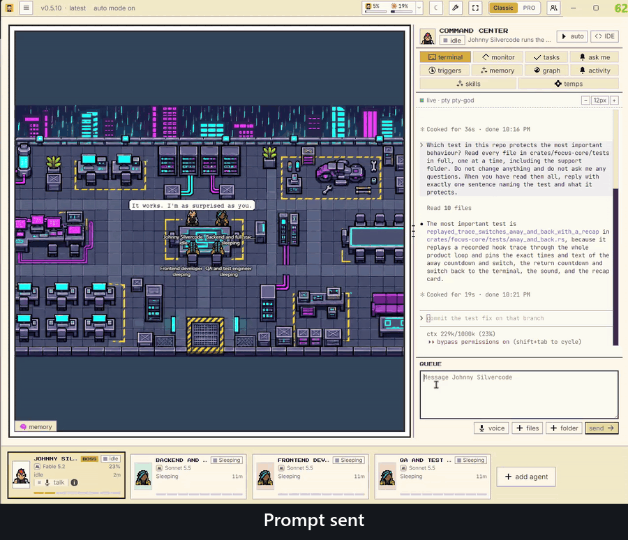
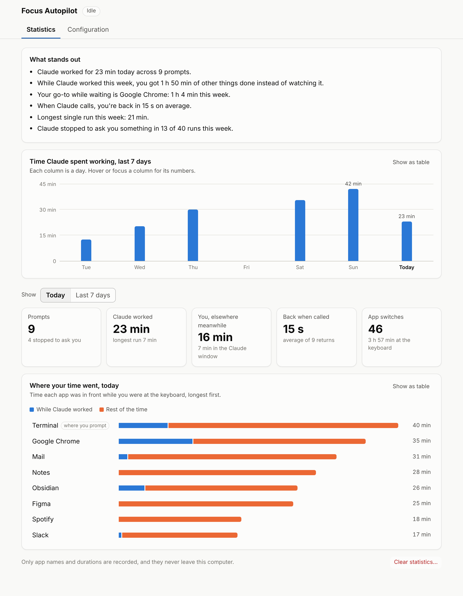

# I built a tool to bring me back to Claude, then found Claude already had one

*November 2026*

I am a product manager, not a Rust developer. Over four days I directed an AI coding agent
(Claude Code) to build a desktop app of about 11,000 lines that runs on macOS and Windows. On
the last day I found out that the app I use it with already does most of what mine does. This
is what I built, what went wrong, and what I would do differently.

The code is at [github.com/firedash/focus-autopilot](https://github.com/firedash/focus-autopilot).

## The itch

Working with a coding agent means sending a prompt and waiting, anywhere from ten seconds to
twenty minutes. I kept doing one of two things: staring at a timer, or wandering off and
finding out much later that Claude had finished long ago.

I wanted something that would let me go and do other work, call me back when Claude was done,
tell me what it did, and then put me back where I was.

## What it does

Focus Autopilot is a small background program. It listens to Claude Code's hooks, which are
messages Claude Code can send when a prompt starts, a tool is used, an approval is needed or
a run ends.

1. I send a prompt and switch to another window.
2. When Claude finishes, a sound plays and a box appears: "Claude is done in api. Back to
   Terminal in 5 s."
3. Five seconds later my Claude window comes forward, with a short recap of what I asked and
   what Claude did.
4. When my next prompt has been running a while, it moves me back to the window I left.

Every switch is announced first and one key stops it. It runs only on my machine, asks for
no operating-system permission, and has a local page with statistics and settings.

## How it was built

I wrote a design document first, then had the agent build it in layers: a core that makes
every decision and touches nothing, a small local server that receives the hooks, and one
adapter per operating system that reads which window is in front and brings windows forward.

Some numbers from the last day:

- About 11,000 lines of Rust and 1,750 of HTML, CSS and JavaScript.
- 243 automated tests, with 97% line coverage on the decision-making core.
- Checks that run on Linux, macOS and Windows machines on every change.
- Six written decision records, including two approaches that were tried and withdrawn.

## What went wrong, and what it taught me

**Tests did not find the bugs that mattered. Using it did.** Every one of these passed the
test suite and failed the first time a person ran the app:

- A leftover setting from an abandoned experiment stopped the app from starting.
- A rule meant to avoid interrupting someone working with a second Claude session also
  caught anyone working in an editor, so the countdown never came.
- Claude reported a helper task finishing a moment after its own "done", and the app read
  that as Claude starting again and cancelled the return.
- On Windows, the diagnostic command reported "another program has the port" when the app
  was simply not running.
- The Windows hotkey I chose was already taken, by the Claude desktop app itself.

**Code written without the machine it runs on costs several rounds.** The Mac adapter was
written from Linux and needed fix after fix once it met a real Mac. For Windows we added a
Windows machine to the automated checks first, and had it start the real program and send it
a message. The Windows version worked on my desktop the same afternoon.

**I changed my mind about the main feature twice.** The first version switched me away and
back automatically. After using it I asked for the opposite: let me go wherever I like and
press a key to return. A reviewer then pointed out that the headline feature of something
called "Autopilot" was off by default. I went back to automatic, this time with a countdown
and a way to return me to wherever I had been. Each reversal was right at the time. Using the
thing was the only way I found out what I wanted.

**One feature had to be withdrawn.** Returning to the exact editor window looked easy. In
practice it opened a stray window whenever Claude was running in a folder slightly different
from the one the editor had open. It is written down in the decision records as tried and
removed, with the reason.

**Honest documentation turned out to be a feature.** The status page separates what a person
has seen working, what only an automated machine has run, and what nobody has tried. Every
reviewer mentioned it. It also kept me honest with myself about how finished the thing was.

## The reactions

I shared it with a group of developer friends and got one GIF. A former colleague replied,
"you just automated alt-tab."

He was right about the mechanism. The switch is alt-tab. What I was trying to solve was
knowing when to press it. But his reply taught me something about the pitch: if you lead with
what the tool does, people hear the mechanism. If you lead with the problem, they recognise
it or they do not, and both answers are useful.

## The punchline

On the last day I was testing on Windows with the Claude desktop app, and a notification
appeared in the corner of my screen. It had the session's name and a one-line summary of what
Claude had done, and clicking it took me back to the app.

That is most of what my tool's return does. I had not known it existed.

What mine still adds is the return with no click, being sent back to where I was, and the
statistics. Whether that is worth running a background program for is an open question, and
I plan to answer it the cheap way: a week of normal work, noticing whether I miss it when it
is off.

## What I would do differently

1. **Check what the platform already does**, not only what competitors do. My design had a
   survey of similar tools. It did not look hard enough at Claude's own app.
2. **Get to one real run on day one.** The most useful hours were the ones spent using it,
   and they came late.
3. **Make it installable before making it complete.** It still needs a compiler to install,
   which is why nobody I shared it with tried it.
4. **Record a 20-second demo before sharing anything.** A link asks people to do work. A GIF
   does not. The one above was made after the first round of sharing, not before.

## What was worth it anyway

The most interesting find was the hooks themselves. A few lines of settings make Claude Code
send a message to any address when something happens. I confirmed which parts of the Claude
desktop app send them (the Code tab with a local folder does; Cowork and cloud sessions do
not). That is worth knowing whatever I build next.

I also learned that a product manager can direct an AI agent through a real piece of
software, across two operating systems, in four days. The judgement about what to build is
still the hard part. The agent built what I asked for, quickly and well. Neither of us
looked at my own notification tray first.

---

*Focus Autopilot is a developer build with no installer. The
[status page](https://github.com/firedash/focus-autopilot/blob/main/STATUS.md) lists what has
been seen working and what has not.*
